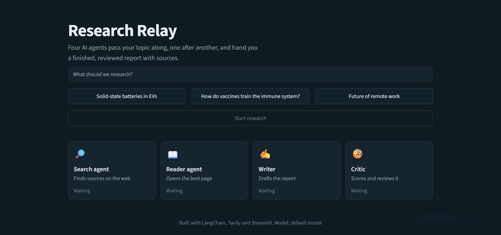
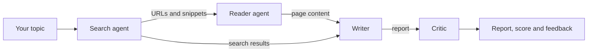

# Research Relay: a multi-agent research assistant

Give it a topic and four AI agents work in sequence: one searches the web, one reads the best source, one writes a structured report, and one reviews it and gives it a score. You get a finished report with sources, plus the critic’s feedback.

**Live demo:** <add your Streamlit link here>



## How it works



| Step | Agent | What it does |
|---|---|---|
| 1 | Search agent | Finds recent sources on the web with Tavily |
| 2 | Reader agent | Picks the best URL and scrapes the page for deeper detail |
| 3 | Writer | Writes an introduction, key findings, conclusion and source list |
| 4 | Critic | Scores the report out of 10 and lists strengths and improvements |

If a website blocks scraping, the pipeline carries on and writes the report from the search results instead of failing.

## Features

- Two tool-using agents built with LangChain’s `create_agent`
- Two prompt chains (writer and critic) for structured output
- Live progress: each agent’s card updates as it works
- Report, critic’s review, clickable sources and raw research in separate tabs
- Download the report as Markdown
- Switch the language model through environment variables

## Tech stack

Python, LangChain, Groq (LLM), Tavily (web search), BeautifulSoup and Requests (scraping), Streamlit (UI)

## Project structure

```
.
├── app.py              # Streamlit interface
├── agents.py           # Model, agents, writer and critic chains
├── tools.py            # web_search and scrape_url tools
├── pipeline.py         # Command-line version of the pipeline
├── requirements.txt
├── .env.example        # Template for your API keys
└── .streamlit/
    └── config.toml     # Dark theme
```

## Run it locally

1. **Clone and enter the project**

   ```bash
   git clone <your-repo-url>
   cd <your-repo-name>
   ```

2. **Create a virtual environment and install dependencies**

   ```bash
   python -m venv venv
   venv\Scripts\activate        # Windows
   source venv/bin/activate     # macOS / Linux
   pip install -r requirements.txt
   ```

3. **Add your API keys.** Copy `.env.example` to `.env` and fill it in:

   - Groq key: https://console.groq.com/keys
   - Tavily key: https://app.tavily.com

4. **Start the app**

   ```bash
   streamlit run app.py
   ```

   It opens at http://localhost:8501. You can also run `python pipeline.py` for the terminal version.

## Deploy on Streamlit Community Cloud

1. Push the repo to GitHub (`.env` is in `.gitignore`, so your keys stay private).
2. At https://share.streamlit.io choose the repo and set the main file to `app.py`.
3. In **Advanced settings → Secrets**, add:

   ```toml
   GROQ_API_KEY = "your-key"
   TAVILY_API_KEY = "your-key"
   ```

## Limitations

- Some sites block scraping, so the reader agent can’t always open the page it picks.
- Free API tiers have rate limits, so very long runs can return a `429` error. Wait a minute and retry.
- Reports are only as good as the sources found. The critic reviews structure and quality, but it does not fact-check.

## Ideas for next steps

- Send the critic’s feedback back to the writer for an automatic second draft
- Let the reader agent scrape several sources instead of one
- Orchestrate the agents with LangGraph
- Save past reports and let users revisit them

## License

MIT